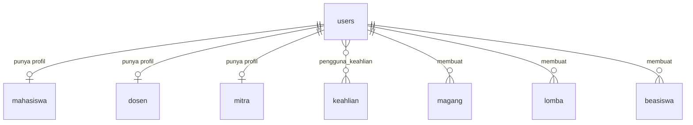

# CampusLink — Bagian 1: Database

Isi: migration semua tabel (sesuai ERD proposal), model + relationship, factory user,
seeder data contoh, dan satu migration khusus Supabase (RLS).

## 1. Siapkan koneksi Supabase

Ambil detail koneksi dari dashboard Supabase (tombol **Connect**). Gunakan **Session pooler**
(port 5432) bila jaringan Anda hanya IPv4. Direct connection hanya IPv6. Jangan pakai
Transaction pooler (port 6543) untuk migration.

Edit `.env` (jangan di-commit):

    DB_CONNECTION=pgsql
    DB_HOST=<host dari dashboard>
    DB_PORT=5432
    DB_DATABASE=postgres
    DB_USERNAME=<user dari dashboard, bentuk pooler: postgres.<project-ref>>
    DB_PASSWORD=<password database>
    DB_SSLMODE=require

    # Disarankan: sesi, cache, dan antrean tidak perlu bolak-balik ke database jarak jauh
    SESSION_DRIVER=file
    CACHE_STORE=file
    QUEUE_CONNECTION=sync

Cek `config/database.php`, bagian `pgsql`. Pastikan baris sslmode membaca env:

    'sslmode' => env('DB_SSLMODE', 'require'),

Pastikan ekstensi PHP `pdo_pgsql` aktif (`php -m | grep pdo_pgsql`).

## 2. Pasang file

Salin ke proyek Laravel, timpa file yang namanya sama:

    app/Models/*                       (User.php menimpa bawaan)
    database/factories/UserFactory.php (menimpa bawaan)
    database/migrations/*              (0001_01_01_000000_create_users_table.php menimpa bawaan)
    database/seeders/*                 (DatabaseSeeder.php menimpa bawaan)

## 3. Jalankan

    php artisan migrate:fresh --seed

PERINGATAN: `migrate:fresh` menghapus SEMUA tabel di schema `public`. Pakai project Supabase
khusus CampusLink, atau pastikan tidak ada tabel lain di sana.

## 4. Cek hasil

    php artisan tinker
    >>> App\Models\User::count()                                  // 12
    >>> App\Models\Mahasiswa::with('user.keahlian')->first()
    >>> App\Models\Mitra::where('status_verifikasi', 'pending')->count()   // 1
    >>> App\Models\Magang::with('user')->get()->count()           // 3

Di Supabase: Table Editor harus menampilkan 13 tabel aplikasi + tabel bawaan Laravel,
dan semuanya berlabel RLS aktif.

Akun contoh (password semuanya `password`, hanya untuk pengembangan):

| Peran | Email |
|---|---|
| Admin | admin@campuslink.test |
| Mahasiswa | alya.putri@polinema.ac.id (dan 5 lainnya) |
| Dosen | rina.kusumawati@polinema.ac.id (dan 2 lainnya) |
| Mitra disetujui | hrd@nusantaratech.example |
| Mitra pending | info@kreasimuda.example |

## ERD

## Keputusan desain (cek apakah sesuai)

1. **Status mitra hanya di `mitra.status_verifikasi`**, tidak diulang di `users`.
   `users.status` (aktif/nonaktif) hanya untuk admin menonaktifkan akun. Mitra baru bisa
   login bila akun aktif DAN status_verifikasi = disetujui (Bagian 3).
2. **Sertifikasi, pelatihan, proyek, pencapaian** mahasiswa disimpan sebagai kolom teks di
   `mahasiswa`, bukan tabel terpisah. Cukup untuk profil teks. Pisahkan jadi tabel bila
   nanti butuh daftar terstruktur.
3. **Kesediaan dosen** dipecah jadi dua boolean (`bersedia_membimbing_magang`, `_lomba`),
   bukan satu teks keterangan, supaya mudah difilter.
4. **`magang`, `lomba`, `beasiswa`** punya `user_id` (pembuat: mitra atau admin) dan
   `penyelenggara` (teks). Kolom `penyelenggara` diperlukan karena informasi buatan admin
   tidak punya profil mitra. Untuk mitra, controller mengisinya dari nama organisasi.
5. **`status` (tayang/disembunyikan)** pada tiga tabel informasi dipakai untuk moderasi
   admin (FA-09). Admin juga bisa menyembunyikan profil direktori lewat `tampil_di_direktori`.
6. **`role` dan `status` ada di `$fillable` User** agar seeder sederhana. Registrasi
   (Bagian 3) wajib mengisinya dari kode server, bukan dari `$request->all()`.
   `status_verifikasi` (Mitra) dan `status` (informasi) sengaja TIDAK di `$fillable`.
7. **Index** hanya pada kolom filter yang kardinalitasnya cukup (`program_studi`, `angkatan`,
   `batas_pendaftaran`). `jurusan` dan `kelas` tidak di-index karena nilainya sedikit.
8. **Hapus akun = hapus data turunannya** (`cascadeOnDelete`): profil, keahlian, dan
   informasi buatannya ikut terhapus.

## Tambahan di luar materi (sudah disetujui lewat penggunaan Supabase)

- Driver `pgsql` dan koneksi Supabase.
- Migration RLS (`DB::statement` raw SQL, hanya jalan di PostgreSQL). Bila Anda menambah
  tabel baru, tambahkan juga `alter table ... enable row level security` pada migration-nya.
